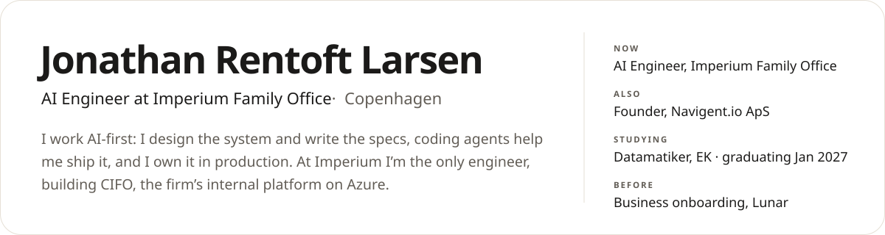
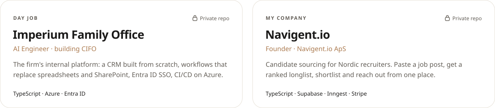

<picture>
  <source media="(prefers-color-scheme: dark)" srcset="assets/about-dark.svg">
  
</picture>

 

  <a href="https://walkietalkey.com"><picture><source media="(prefers-color-scheme: dark)" srcset="assets/btn-walkietalkey-dark.svg"></picture></a>&nbsp;
  <a href="https://www.linkedin.com/in/jonathan-rentoft-larsen-b6b09a221"><picture><source media="(prefers-color-scheme: dark)" srcset="assets/btn-linkedin-dark.svg"></picture></a>&nbsp;
  <a href="mailto:jonathan0912@gmail.com"><picture><source media="(prefers-color-scheme: dark)" srcset="assets/btn-email-dark.svg"></picture></a>

<a href="https://github.com/JonathanRentoft/walkietalkey">
  <picture>
    <source media="(prefers-color-scheme: dark)" srcset="assets/projects-dark.svg">
    
  </picture>
</a>

 

<picture>
  <source media="(prefers-color-scheme: dark)" srcset="assets/work-dark.svg">
  
</picture>

  

  <picture>
    <source media="(prefers-color-scheme: dark)" srcset="https://skillicons.dev/icons?i=rust%2Cts%2Creact%2Ctauri%2Cbun%2Cpy%2Cpytorch%2Cazure%2Csupabase%2Cvercel%2Ccloudflare%2Castro%2Ctailwind%2Cjava&theme=dark&perline=14">
    
  </picture>

